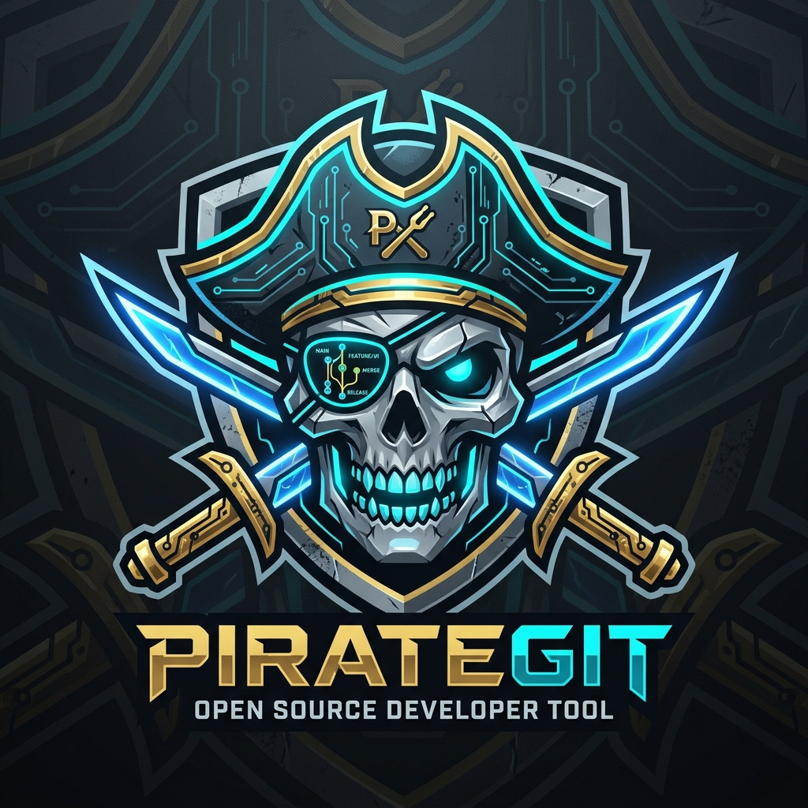

<div align="center">



# 🏴‍☠️ PirateGit

**Don't reinvent the wheel — plunder it.**  
*Multi-channel open-source intelligence, architectural blueprinting & surgical code scavenger skills for AI coding agents.*

[](LICENSE)
[](https://python.org)
[](#installation)

</div>

---

## ⚡ The 2 Core Commands

PirateGit adds two high-leverage slash commands powered by specialized subagents to your AI coding assistant (Antigravity, Claude Code, Cursor, Codex):

```text
/explore  ──►  Reconnaissance Fleet: Synthesizes your North Star, dispatches parallel Pirate Scouts
               across GitHub, Topics, HN & Reddit, and runs zero-clone X-rays + DAFO.

/loot     ──►  Architecture & Quality Tribunal: Designs or forks baseline project structure, harvests
               to others/, transplants clean code into src/, assets/ & tests/, and runs Critic + Judge.
```

---

## 📂 100% Self-Contained Skill Architecture

Each skill is completely decoupled and self-contained with its own executable scripts inside its folder:

```text
PirateGit/
├── skills/
│   ├── common/                       # Single shared core (network, scoring, channels, tree)
│   │   ├── utils.py                  # Zero-quota HTTP, caching, licenses & slug parser
│   │   ├── channels.py               # GitHub API, Topics, HN Algolia & Reddit public search
│   │   ├── scoring.py                # DeepGit composite scoring formula
│   │   └── tree.py                   # Anatomical zero-clone tree parser & hygiene calculator
│   │
│   ├── explore/
│   │   ├── SKILL.md                  # Reconnaissance protocol
│   │   └── scripts/
│   │       ├── explore.py            # 4-channel search & DeepGit scoring
│   │       ├── xray.py               # Zero-clone anatomical tree inspection
│   │       └── peek.py               # Zero-quota file reader
│   │
│   └── loot/
│       ├── SKILL.md                  # Architecture, baseline adoption, harvesting & tribunal protocol
│       └── scripts/
│           ├── harvest.py            # Quarantine downloader into others/
│           ├── files.py              # File-tree path filter
│           └── peek.py               # Zero-quota file reader
│
├── docs/assets/                      # Badges, logo, and illustrations
├── install.ps1 / install.sh          # One-line cross-platform installers (distributes common to skills)
├── README.md
└── LICENSE
```

---

## 1. `/explore` — Multi-Agent Scouting & Intelligence

<div align="center">
  
</div>

Synthesizes your ultimate objective, deploys a **fleet of parallel scouting subagents** across public platforms, reads candidate READMEs without burning API quota, runs anatomical zero-clone `xray` checks, and returns a ranked **Loot Table** + **SWOT (DAFO)** analysis.

### Chat Syntax
```text
/explore                                  # Context-aware: reads current repo & finds similar projects
/explore <your goal or feature>           # Scans 100 repositories by default
/explore <your goal> --150repos           # Override default scope
/explore <your goal> --50repos
```

### Examples
```text
/explore automatic pcb placement in python
/explore markdown parsing with AST and table support
/explore local rag vector search without external apis --50repos
```

### What You Get in Response:
1. **Target Frame:** Your North Star goal, hard requirements, and discard criteria (red lines).
2. **Multi-Angle Expansion & Fleet Triage:** Expands queries across 3 vectors (Direct Synonyms, Lateral Domains, Subsystems/Internal Parts) and reviews **100 candidate repositories** across GitHub, Topics, Hacker News, and Reddit.
3. **Structured SWOT (DAFO) Table (Top Candidates):** Side-by-side comparison table featuring Strengths, Weaknesses, Loot Opportunities, and Licensing Threats for top candidates (10 is an orientative baseline; includes more when they offer distinct value).
4. **Ranked Loot Table (Top Candidates):** Sorted by composite score, commercial license traffic light (`🟢 Permissive / 🟡 Copyleft / 🔴 No License`), language/size, and exact scavengeable assets (datasets, algorithms, prompts, libraries).
5. **Full Tables on Demand:** Clear footer notice to prompt the agent whenever you want to see the remaining repositories or deep-dive into any specific candidate.

---

## 2. `/loot` — Blueprints, Baseline Adoption & Quality Tribunal

<div align="center">
  
</div>

Takes the intelligence gathered from `/explore`, establishes or aligns the target architecture, harvests selected repositories into a local quarantine cache (`others/`), transplants clean data and code step-by-step into your codebase, and subjects all ported code to an **adversarial Quality Tribunal (Critic + Judge)**.

### Empty Workspace? Fast-Track Baseline Adoption
If your project is empty or greenfield and one of the explored repositories already has a solid, battle-tested architecture matching your goal:
- `/loot` proposes adopting that repository as the **Architectural Baseline**.
- Extracts its structural foundation into standard industry layout:
  - `src/`: Core domain logic, engines, models, and interfaces.
  - `tests/`: Unit and integration test suites.
  - `assets/` (or `data/`): Curated datasets, fixtures, and schemas.
- Then prunes unneeded modules and transplants superior algorithms from other candidates.

### Chat Syntax
```text
/loot [freeform instructions, preferences, exclusions, or repo targets...]
```

### Examples
```text
# Inherit top recommendations from /explore automatically:
/loot

# Greenfield project: adopt repoA structure as baseline and transplant repoB engines:
/loot empty project, adopt repoA architecture as baseline and port repoB algorithms into src/

# Specify exact sources and exclusions:
/loot use the dataset from viaduct and the placement engine from eda-agent, but ignore altium stuff

# Direct to a specific architectural target:
/loot only the stackup json and routing algorithms, adapt them to our src layout with assets/ and tests/
```

### How the Agent Executes `/loot`:
1. **Architectural Alignment & Zero-Args Inference:** Automatically inherits top candidate repositories and identified loot from `/explore` (or interprets user-specified exclusions).
2. **Harvest (`others/`) & Stage (`staging/`):** Downloads candidate repositories into quarantine (`others/`) and stages only the 3–8 specific files selected for integration into a temporary `staging/` work queue.
3. **Progressive Burn-Down Transfusion (`staging/` $\rightarrow$ `src/`):**
   - Transfuses one staged file at a time into `src/` or `assets/` with clean architecture and unit tests in `tests/`.
   - The minitool (`stage.py complete`) automatically stamps the `[PIRATEGIT LOOT PROVENANCE]` block into the code, logs it in `projects.md`, and burns down (deletes) the file from `staging/`.
4. **Mandatory Quality Tribunal:**
   - 🕵️ **The Critic Subagent:** Verifies that all unit tests pass, zero dead dependencies remain, and `staging/` is 100% burned down (empty).
   - ⚖️ **The Judge Subagent:** Reviews findings and outputs the **Loot Provenance Inventory Table** (Origin, License, Production Status) and signs off (`🟢 PROVENANCE AUDITED & READY FOR EXPERIMENTATION`).

---

## 🛠️ Direct Terminal CLI Usage

Because each script is a standalone Python stdlib utility, you can also run them directly from your terminal:

```bash
# 1. Multi-channel search, README triage & composite signal scoring
python skills/explore/scripts/explore.py "query 1" "query 2" --topics topic-name --50repos

# 2. Anatomical file-tree dissection of repos without cloning
python skills/explore/scripts/xray.py owner1/repo1 owner2/repo2

# 3. Read specific files with zero API quota
python skills/explore/scripts/peek.py owner/repo path/to/file.py --max-lines 80

# 4. Filter repository paths by keywords
python skills/loot/scripts/files.py owner/repo placement router

# 5. Harvest selective files or full repository ZIP into others/
python skills/loot/scripts/harvest.py owner/repo --dest others --paths path/to/file.py
```

---

## 🚀 One-Line Installation

### Windows (PowerShell)
```powershell
irm https://raw.githubusercontent.com/username/PirateGit/main/install.ps1 | iex
```

### macOS / Linux (Bash)
```bash
curl -fsSL https://raw.githubusercontent.com/username/PirateGit/main/install.sh | bash
```

### Manual Installation (Drop into any project)
Simply copy the `skills/explore` and `skills/loot` folders directly into any project's `.agents/skills/` directory:

```text
MyProject/
└── .agents/
    └── skills/
        ├── explore/       # 👈 Self-contained, works out of the box
        └── loot/          # 👈 Self-contained, works out of the box
```

---

## 📄 License

MIT License — Free for personal and commercial use.
